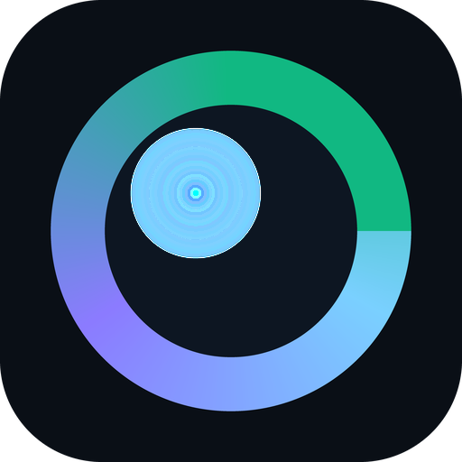
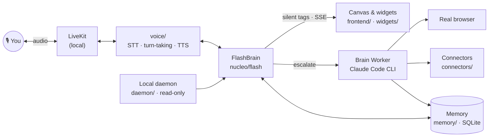

<div align="center">



# Zaelar

**A personal AI agent you talk to — self-hosted, with memory, a real browser and hands.**

You speak, it answers in under a second, remembers what matters, and goes off to do the slow work
(browse, book, search, write to your contacts) while you keep talking.

[Website](https://zaelar.com) · [Technology](https://zaelar.com/technology/) · [Architecture](https://zaelar.com/technology/architecture/) · [Guide](https://zaelar.com/guide/) · [Developers](https://zaelar.com/technology/developers/)


<br>

<a href="https://www.youtube.com/watch?v=CPPmHjkYxfw" title="Watch the Zaelar demo on YouTube">
  
</a>

**▶ [Watch the demo](https://www.youtube.com/watch?v=CPPmHjkYxfw)** · more on [YouTube](https://www.youtube.com/@zaelar_ai)

</div>

---

## What it is

Zaelar is not a chatbot. It is the place where your agent **lives**: a voice-first desktop on
`localhost` where the conversation drives everything on screen — widgets, a real browser, your agenda,
your messages, your files.

- **Voice first.** Streaming speech in and out over a local LiveKit server; the voice turn is answered by a
  fast, non-reasoning model so it feels like a conversation, not a form.
- **Two brains.** *FlashBrain* owns the sub-second turn. When a task needs time it hands it to a
  *Brain Worker* — a headless coding-agent CLI that browses, reads and acts — and keeps talking while it works.
- **Memory that behaves like memory.** One local SQLite file (vectors + FTS5 + graph + forgetting), distilled
  after every turn and consolidated at night.
- **Widgets, not walls of text.** Agenda, maps, music, video, photos, documents, messaging — opened,
  filled and closed by voice.
- **Connectors.** Google (Calendar, Contacts, Drive), email (IMAP), Telegram, WhatsApp, Spotify, photos and
  more — credentials stay on your machine.
- **Your files, on your terms.** A tiny read-only daemon serves only the folders you allow.
- **Speaks your language.** English and Spanish ship built in; any of forty others is generated on first run.
- **Reaches the outside world.** For bookings, travel, events and thousands of other services, Zaelar works
  with the agents available on the [MeshKore network](https://meshkore.com), external MCP servers and
  third-party APIs — and falls back to its own browser for everything else.

### What's in this repo, and what's external

| In this repository | External services Zaelar uses |
|---|---|
| the voice engine, the two brains, the memory, the canvas and its apps, the connectors, the local daemon | **agents on the MeshKore network** — independent specialists Zaelar discovers and calls for an errand; the network grows on its own, no update needed here |
| | **external MCP servers** — third-party tools the Brain Worker's agent CLI can call during a task |
| | **third-party APIs** — language and speech models, search, and the accounts you connect (Google, Spotify, messaging…) |

Zaelar orchestrates those services; it doesn't reimplement them. What they offer is defined by each provider.

## Architecture at a glance



Three decoupled layers — **voice + canvas** (the only user surface), **the brain** (`nucleo/`, decides and
acts) and **compute** (short-lived agents that build widgets and exit). The full model, with every seam, is in
[`zaelar-architecture.md`](.meshkore/docs/architecture/zaelar-architecture.md) and on
[zaelar.com/technology](https://zaelar.com/technology/).

## Quick start

You need **[Python 3.11+](https://python.org/downloads)** and about **3 GB** of free disk. Zaelar installs
everything else **into its own folder** — nothing system-wide, **no Docker**.

**macOS / Linux**
```bash
git clone https://github.com/meshkore/zaelar
cd zaelar
./zaelar          # checks your system, sets up, and starts
```

**Windows (PowerShell)**
```powershell
git clone https://github.com/meshkore/zaelar
cd zaelar
.\zaelar.ps1      # checks your system, sets up, and starts
```

Then open **http://localhost:43917** and follow the on-screen setup. You pick a language, add your AI keys
**in the app** — no `.env` editing, no config files — and it greets you.

> **No HTTPS, on purpose.** A local install is plain HTTP on `localhost`: browsers treat it as a secure
> context (the microphone works) and nothing leaves your machine, so there is no certificate to issue, install
> or renew.

### For the Brain Worker: one extra CLI

The voice works with keys alone. The agent that **browses and acts** is driven through a coding-agent CLI, so
install [Claude Code](https://docs.anthropic.com/en/docs/claude-code) once (`claude` on your `PATH`). Zaelar
points it at the model in the table below — it does not need an Anthropic subscription.

## Models and keys

Zaelar brings no model of its own and holds no key of yours in the repo. Every piece has a **titular** and one
**stand-in**, and you can change any of them from the settings panel. These are the defaults
([`config/models.default.json`](config/models.default.json)):

| Piece | What it does | Default | Stand-in | Key |
|---|---|---|---|---|
| **FlashBrain** | the voice and chat turn | DeepSeek `deepseek-flash` | OpenAI `gpt-4.1-mini` | `DEEPSEEK_API_KEY` |
| **Brain Worker** | browses and executes, via Claude Code | Z.AI `glm-5.3` | DeepSeek | `Z_AI_API_KEY` |
| **Memory** | distils every turn; nightly consolidation | DeepSeek | OpenAI | `DEEPSEEK_API_KEY` |
| **Embeddings** | the semantic space of the memory | OpenAI `text-embedding-3-small` (768 dims) | — (none, by design) | `OPENAI_API_KEY` |
| **Speech-to-text** | streaming transcription | Deepgram | Mistral Voxtral | `DEEPGRAM_API_KEY` |
| **Text-to-speech** | the voice you hear | Inworld | ElevenLabs | `INWORLD_API_KEY` |

**The short list for full voice:** DeepSeek, OpenAI, Deepgram and Inworld (or ElevenLabs). Add Z.AI for the
Brain Worker's default model; without it the worker uses its DeepSeek stand-in. Web search can use Gemini,
OpenAI, Perplexity, Tavily or Brave — whichever keys you have.

**Prefer to keep audio on your machine?** Free local speech is one script away:

| | macOS (Apple Silicon) | Windows |
|---|---|---|
| Speech-to-text — Whisper (MLX / faster-whisper) | `scripts/install-stt-mac.sh` | `scripts/install-stt-win.ps1` |
| Text-to-speech — Kokoro | `scripts/install-tts-mac.sh` | `scripts/install-tts-win.ps1` |

Then choose them in ⚙ settings. Every key and how to check it: `./zaelar doctor`.

**Prefer to keep the memory's embeddings on your machine?** The free, fully local option is Google's
`embeddinggemma` through [Ollama](https://ollama.com) (768 dims, multilingual):

```bash
ollama pull embeddinggemma
```

then pick **Ollama (local, free)** under *Memory · embeddings* in ⚙ settings, or set
`ZAELAR_EMBED_BACKEND=ollama` and `ZAELAR_EMBED_MODEL=embeddinggemma`. Three things worth knowing:

- **Embeddings have no stand-in.** A different model is a different vector space, so a second model would not
  answer the same question — it would corrupt recall and dedup. When the provider is down, memories are still
  written (marked `embed_pending`), search falls back to keywords, and the nightly REM pass re-embeds them.
- **Changing the embedding model is a migration, not a setting.** Choosing another model re-embeds your whole
  memory in the new space and reseals it (`memory/reembed.py`); until you change it, an existing install keeps
  the space it was indexed with.
- **Semantic dedup is calibrated per model.** `embeddinggemma` has measured thresholds; a model without them
  keeps exact and slot dedup only. `python -m tests.memory.benchmarks.calibrate_dedup --db <copy of zaelar.db>` measures a new one.

The whole on-machine stack (local speech + a local chat model + local embeddings) is the `local` profile, read
from the `local` block of [`config/models.default.json`](config/models.default.json).

## Commands

Identical on macOS, Linux and Windows (use `.\zaelar.ps1` instead of `./zaelar` on Windows):

| Command | What it does |
|---|---|
| `./zaelar` | First run: check → setup → start. After that: just starts. |
| `./zaelar up` | Start it in the **background** and give you your prompt back. |
| `./zaelar stop` | Stop it, and unload any local models so they stop draining the battery. |
| `./zaelar restart` | Stop + start. This is how you pick up code you just changed. |
| `./zaelar status` | Is it running? On which ports? Which build? |
| `./zaelar start` | Run it in the **foreground** with the logs on screen (Ctrl-C quits). |
| `./zaelar doctor` | Check that your system meets the requirements and which keys are present. |
| `./zaelar setup` | Create the local environment and install dependencies. |
| `./zaelar update` | Pull the latest version and re-setup. |

Working on the code? `make start` / `make stop` / `make restart` / `make status` do the same thing.

### Always the same ports

Zaelar starts on the **same fixed ports every time**, and the app and its helpers answer only on your own
machine (`127.0.0.1`). Bookmark **http://localhost:43917** — it will not move.

| Port | What |
|---|---|
| **43917** | the app — the only address you open |
| 44917 | the voice worker's health check (app port + 1000) |
| 7880 · 7881 | the local LiveKit server (voice signalling · media over TCP) |
| 45817 | the local daemon (the folders you allow it to read) |
| 3111 | the WhatsApp bridge, when connected |

`./zaelar start` on a running instance says so instead of starting a second one, and `./zaelar stop` frees
every port in this list. Another port for the app? `PORT=…`; the worker follows it (+1000). The list lives in
`scripts/zaelar.py` (`PORTS`).

## Your own files

Zaelar can read the folders you choose on your own computer through a small companion service, the
**local daemon** — and if you are running Zaelar from this repository there is **nothing to install**: it is a
Python package in `daemon/`, it has **no dependencies at all** (standard library only), and `./zaelar` starts
it beside the engine on macOS, Linux and Windows alike.

Open Zaelar, click the **🖥 icon at the top right**, and choose which folders it may read. It can read
**nothing** until you do.

| Command | What it does |
|---|---|
| `make daemon` | Run just the daemon in the foreground (equivalently `python -m daemon`). |
| `python -m daemon status` | Is it up? Which folders are allowed? |
| `python -m daemon allow ~/Documents` | Allow a folder from the terminal instead of the screen. |
| `python -m daemon deny ~/Documents` | Stop reading it. |

It is **read-only**, it listens on **127.0.0.1 only**, and keys, credential files, browser cookie stores and
`.git` internals are never served **even inside a folder you allowed**. Every operation, allowed or refused,
is written to an audit log you own. The threat model:
[`zaelar-daemon-security.md`](.meshkore/docs/security/zaelar-daemon-security.md).

## Your data is yours

Everything Zaelar knows lives inside this folder, on your machine: the memory is one SQLite file, credentials
are owner-only files, and nothing is synced anywhere. No account, no telemetry to us, no lock-in — and because
the source is public, you can read exactly what runs on your data. Delete the folder and it is gone.

## Requirements

- **macOS, Windows or Linux.**
- **Python 3.11+** — the only thing you install yourself (plus the Claude Code CLI for the Brain Worker).
- ~3 GB free disk, 8 GB RAM recommended.
- An internet connection for the first setup.
- Your own AI provider keys — added later, in the app.

Everything else (voice server, models, dependencies) is fetched into `.venv/` and `bin/` **inside this folder**.

## How the repository is organised

| Folder | What lives there |
|---|---|
| [`server/`](server) | FastAPI app — transport and composition root; runs the voice engine in-process |
| [`voice/`](voice) | the voice trunk: STT, turn-taking, audio filtering, TTS, LiveKit plumbing |
| [`nucleo/`](nucleo) | the brain — FlashBrain, the Brain Workers, the loop, proactivity, homeostasis |
| [`memory/`](memory) | the central memory: one SQLite file with vectors, FTS5, a graph and forgetting |
| [`widgets/`](widgets) | everything you see on the canvas, each widget self-contained |
| [`connectors/`](connectors) | Google, email, Telegram, WhatsApp, Spotify, photos, the MeshKore network… |
| [`search/`](search) | the search service — one door in, one result shape out |
| [`frontend/`](frontend) | a thin ES-module shell, no build step, no business logic |
| [`daemon/`](daemon) | the read-only local file daemon (standard library only) |
| [`i18n/`](i18n) | the multilingual layer — shipped bundles plus on-demand generation |
| [`library/`](library) · [`files/`](files) | the agent's own filesystem and the file APIs |
| [`bus/`](bus) · [`observability/`](observability) | in-process event bus; who, when and in which flow |
| [`config/`](config) | settings, profiles, the model table, `doctor` |
| [`update/`](update) | the update channel — one build number you can compare |
| [`scripts/`](scripts) · [`tools/`](tools) | the `zaelar` launcher, installers, maintenance |
| [`tests/`](tests) | ~13,000 tests, organised by area, with a hang-aware runner |
| [`.meshkore/`](.meshkore) | the engineering docs: architecture, modules, conventions, security, ops |

## Documentation

| | |
|---|---|
| **Product & concepts** | [zaelar.com/guide](https://zaelar.com/guide/) |
| **Technology** | [FlashBrain](https://zaelar.com/technology/flashbrain/) · [Brain Workers](https://zaelar.com/technology/brainworkers/) · [Memory](https://zaelar.com/technology/memory/) · [Architecture](https://zaelar.com/technology/architecture/) · [Developers](https://zaelar.com/technology/developers/) |
| **Architecture (source)** | [`zaelar-architecture.md`](.meshkore/docs/architecture/zaelar-architecture.md) · [`zaelar-memory.md`](.meshkore/docs/architecture/zaelar-memory.md) · [`zaelar-i18n.md`](.meshkore/docs/architecture/zaelar-i18n.md) · [the MeshKore network](.meshkore/docs/architecture/zaelar-meshkore-network.md) |
| **Modules** | [module map](.meshkore/docs/modules/zaelar-module-map.md) · [first run](.meshkore/docs/modules/zaelar-first-run.md) · [search](.meshkore/docs/modules/zaelar-search.md) · [update channel](.meshkore/docs/modules/zaelar-update-channel.md) |
| **Security** | [`zaelar-security.md`](.meshkore/docs/security/zaelar-security.md) · [daemon threat model](.meshkore/docs/security/zaelar-daemon-security.md) |
| **Contributing & testing** | [`tests/README.md`](tests/README.md) · [conventions](.meshkore/docs/conventions/zaelar-conventions.md) |

## Testing

```bash
make tier0                            # < 60 s — lint, syntax, and every test your diff can reach
./.venv/bin/python tests/watchdog.py  # the whole deterministic suite, chunked, hang-aware
```

Read [`tests/README.md`](tests/README.md) before changing anything — it is the contract for humans and
agents alike.

## Zaelar Cloud

Don't want to run it yourself? **Zaelar Cloud** runs the same engine for you — ready in minutes, automatic
updates, managed backups, no maintenance. → [zaelar.com](https://zaelar.com)

## License

Zaelar is **[fair-code](https://faircode.io)**, distributed under the
[**Sustainable Use License 1.0**](LICENSE.md) (the license n8n pioneered):

- **Free to use for yourself** — self-host it for personal use or for your own internal business
  purposes, modify it, read every line.
- **Not free to commercialize** — you may not sell it, offer it as a hosted service, or build a
  commercial product on top of it. Commercial hosting is what [Zaelar Cloud](https://zaelar.com) is.
- Third-party components keep their own licenses — notably `connectors/whatsapp/bridge/` is
  MIT-licensed code vendored from [Hermes Agent](https://github.com/NousResearch/hermes-agent)
  (Nous Research); see the LICENSE file in that directory.

This is a source-available license, not an OSI-approved open-source license: the source is public and
yours to run, but the commercial rights stay with Zaelar.

<div align="center"><sub>Zaelar — an Asimovia company.</sub></div>
